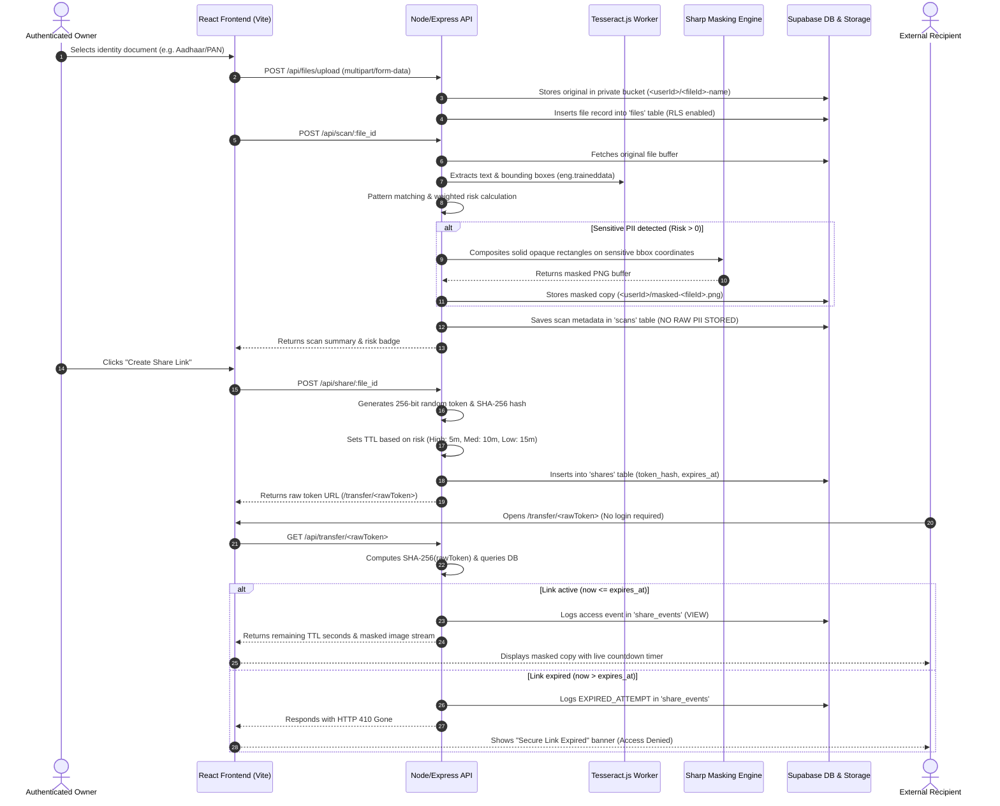

# PRIVACLOUD AI — Privacy-Aware Cloud Storage and Secure File Sharing

[](LICENSE)
[](https://vitejs.dev/)
[](https://expressjs.com/)
[](https://supabase.com/)
[]()

> **PRIVACLOUD AI** is an advanced, privacy-first cloud storage and secure document sharing system. It automatically identifies Indian Personally Identifiable Information (PII) — such as **Aadhaar numbers**, **PAN cards**, **mobile phone numbers**, and **email addresses** — in uploaded image documents via OCR, computes an objective sensitivity risk score, generates an opaque redacted copy, and provisions cryptographically secured sharing links with server-enforced expiration.

---

## 🌟 Key Highlights & Core Capabilities

- 🔐 **Authenticated Private Vault**: Built on **Supabase Auth** and **Supabase Storage**. User documents are isolated via PostgreSQL Row-Level Security (`auth.uid() = user_id`) and private folder segmentation.
- 🔍 **Automated Privacy Scanner**: Combines **Tesseract.js OCR** with deterministic regular expression pattern matching to extract text blocks, words, and exact bounding box coordinates.
- ⚖️ **Weighted Sensitivity Risk Engine**:
  - **Aadhaar**: $40\text{ points}$
  - **PAN Card**: $30\text{ points}$
  - **Phone Number**: $10\text{ points}$
  - **Email Address**: $10\text{ points}$
  - Categorizes files into **Low Risk** ($0-19$), **Medium Risk** ($20-49$), and **High Risk** ($50-100$).
- 🛡️ **Permanent Pixel-Level Masking**: Uses **Sharp** to overlay solid black opaque rectangles directly into the raster image buffer with $+4\text{px}$ safety padding. The original file remains untouched in the user's private vault.
- ⏱️ **Server-Enforced TTL & HTTP 410 Gone**:
  - **High Risk**: Expires in **5 minutes**
  - **Medium Risk**: Expires in **10 minutes**
  - **Low Risk**: Expires in **15 minutes**
  - Uses 256-bit cryptographically secure random tokens (`crypto.randomBytes(32)`).
  - Database stores only the **SHA-256 hash** of the token.
  - Expired links strictly return **HTTP 410 Gone**, permanently preventing further access.
- 📊 **Privacy-Preserving Analytics**: Interactive **Recharts** dashboard displaying document risk distributions, detection frequencies, and share lifecycles without storing or revealing any raw sensitive strings.

---

## 🏗️ System Architecture & Data Flow



---

## 📁 Repository Structure

```
Cloudy AI/
├── backend/                         # Express.js REST API
│   ├── src/
│   │   ├── config/
│   │   │   └── supabase.js          # Supabase client & offline fallback store
│   │   ├── controllers/
│   │   │   ├── fileController.js    # Upload, list, delete vault files
│   │   │   ├── scanController.js    # OCR execution, risk scoring, masking
│   │   │   ├── shareController.js   # Cryptographic token generation & TTL
│   │   │   ├── transferController.js# Public transfer & HTTP 410 Gone enforcement
│   │   │   └── analyticsController.js# Metadata aggregation (zero raw PII)
│   │   ├── middleware/
│   │   │   ├── authMiddleware.js    # Supabase JWT validation & demo fallback
│   │   │   └── uploadMiddleware.js  # Multer memory storage & MIME filtering
│   │   ├── routes/                  # Express route definitions
│   │   ├── services/
│   │   │   ├── ocrService.js        # Tesseract.js worker management
│   │   │   ├── scannerService.js    # PII pattern scanning & bounding boxes
│   │   │   ├── maskingService.js    # Sharp pixel compositing
│   │   │   └── shareService.js      # Token hashing & TTL validation
│   │   ├── utils/
│   │   │   └── patterns.js          # Regex definitions & risk weight formulas
│   │   ├── app.js                   # Helmet, CORS, Rate-limiting, Routes
│   │   └── server.js                # Server entry point
│   ├── tests/                       # Unit & integration tests
│   │   ├── patterns.test.js         # PII regex & risk formula tests
│   │   ├── masking.test.js          # Sharp pixel redaction tests
│   │   ├── share.test.js            # TTL & HTTP 410 tests
│   │   └── ocr_integration.test.js  # End-to-end OCR test
│   ├── package.json
│   └── .env.example
├── frontend/                        # React (Vite) Single-Page Application
│   ├── src/
│   │   ├── components/
│   │   │   ├── Navbar.jsx           # Main top navigation & user status
│   │   │   ├── RiskBadge.jsx        # Color-coded sensitivity badges
│   │   │   ├── ShareModal.jsx       # Share link generator with TTL notice
│   │   │   └── MaskedPreviewModal.jsx# Side-by-side masked viewer
│   │   ├── context/
│   │   │   └── AuthContext.jsx      # Supabase Auth provider
│   │   ├── pages/
│   │   │   ├── Login.jsx            # Sign In page (+ Quick Demo Login)
│   │   │   ├── Signup.jsx           # Registration page
│   │   │   ├── Dashboard.jsx        # Metrics cards & recent vault files
│   │   │   ├── MyFiles.jsx          # File management, filters, and actions
│   │   │   ├── UploadScan.jsx       # Drag & drop upload + live OCR scanning
│   │   │   ├── Analytics.jsx        # Recharts visual analytics
│   │   │   └── TransferPage.jsx     # Public recipient transfer portal
│   │   ├── services/
│   │   │   ├── api.js               # REST client for backend
│   │   │   └── supabaseClient.js    # Supabase JS client
│   │   ├── App.jsx                  # Protected & public routing
│   │   ├── index.css                # Tailwind CSS & animations
│   │   └── main.jsx
│   ├── package.json
│   ├── tailwind.config.js
│   ├── vite.config.js
│   └── .env.example
├── supabase/
│   └── schema.sql                   # PostgreSQL schema, indices & RLS policies
├── sample-data/                     # Synthetic test documents
│   ├── generate_sample_docs.js      # Generator script
│   ├── sample_identity_high_risk.png
│   ├── sample_pan_medium_risk.png
│   └── sample_cert_low_risk.png
├── docs/
│   ├── DEMO_SCRIPT.md               # 5-minute evaluation demonstration guide
│   └── VIVA_PREP.md                 # Complete viva Q&A defense document
└── README.md
```

---

## ⚙️ Quick Start Guide

### Prerequisites
- **Node.js**: v18.0.0 or higher (Tested on Node v24.x LTS)
- **npm**: v9.x or higher

### 1. Clone & Setup Backend
```bash
cd backend
npm install
cp .env.example .env
npm run dev
```
The backend server runs on `http://localhost:5000`.

> **Note on Offline / Standalone Mode**: If Supabase credentials are left as default in `.env`, the backend will automatically run in **Local Sandbox Mode**, using an in-memory transactional store and storage cache so you can test all upload, scan, mask, share, and analytics flows without external services!

### 2. Setup Frontend
```bash
cd ../frontend
npm install
cp .env.example .env
npm run dev
```
The frontend application runs on `http://localhost:5173`.

### 3. Run Automated Tests
```bash
cd ../backend
npm test
```
Runs the full test suite verifying regex patterns, risk scoring thresholds, TTL calculation, token SHA-256 hashing, Sharp image masking, and HTTP 410 Gone behavior.

---

## 🗄️ Database Schema & Security Policies

Run `supabase/schema.sql` in your Supabase SQL Editor.

```sql
-- Files Table (Owner isolated via RLS)
CREATE TABLE public.files (
    id UUID PRIMARY KEY DEFAULT gen_random_uuid(),
    user_id UUID NOT NULL REFERENCES auth.users(id) ON DELETE CASCADE,
    filename TEXT NOT NULL,
    storage_path TEXT NOT NULL,
    mime_type TEXT NOT NULL,
    size_bytes BIGINT NOT NULL DEFAULT 0,
    created_at TIMESTAMPTZ NOT NULL DEFAULT now()
);

-- Scans Table (Stores risk metadata only; ZERO raw sensitive text)
CREATE TABLE public.scans (
    id UUID PRIMARY KEY DEFAULT gen_random_uuid(),
    file_id UUID NOT NULL UNIQUE REFERENCES public.files(id) ON DELETE CASCADE,
    risk_score INTEGER NOT NULL DEFAULT 0 CHECK (risk_score >= 0 AND risk_score <= 100),
    risk_level TEXT NOT NULL CHECK (risk_level IN ('Low', 'Medium', 'High')),
    count_aadhaar INTEGER NOT NULL DEFAULT 0,
    count_pan INTEGER NOT NULL DEFAULT 0,
    count_phone INTEGER NOT NULL DEFAULT 0,
    count_email INTEGER NOT NULL DEFAULT 0,
    masked_path TEXT,
    scanned_at TIMESTAMPTZ NOT NULL DEFAULT now()
);

-- Shares Table (Cryptographic random token hash with server-enforced TTL)
CREATE TABLE public.shares (
    id UUID PRIMARY KEY DEFAULT gen_random_uuid(),
    file_id UUID NOT NULL REFERENCES public.files(id) ON DELETE CASCADE,
    token_hash TEXT NOT NULL UNIQUE,
    expires_at TIMESTAMPTZ NOT NULL,
    masked_copy_flag BOOLEAN NOT NULL DEFAULT true,
    created_at TIMESTAMPTZ NOT NULL DEFAULT now()
);
```

---

## 🛡️ Security Details & Threat Model

| Threat / Risk | Mitigation in PRIVACLOUD AI |
|---|---|
| **Identity Theft via Cloud Storage** | Original file is stored strictly in private vault; only redacted copies are shareable. |
| **Token Guessing / Enumeration (IDOR)** | 256-bit entropy random tokens; DB stores only SHA-256 hash. |
| **Link Leaks / Permanent Exposure** | Server-enforced TTL countdown; HTTP 410 Gone immediately revokes access. |
| **Database Data Leakage / Subpoena** | Zero plaintext PII stored in DB. Even with full database access, no Aadhaar or PAN numbers can be recovered. |
| **Tenant Data Bleed** | PostgreSQL Row-Level Security (RLS) ensures users can only query their own files. |
| **Mask Removal in PDF/Images** | Sharp overlays pixel-level solid fills into the raster bitmap, irreversibly discarding the underlying pixels. |

---

## 📄 License
This project is open-sourced under the MIT License.
